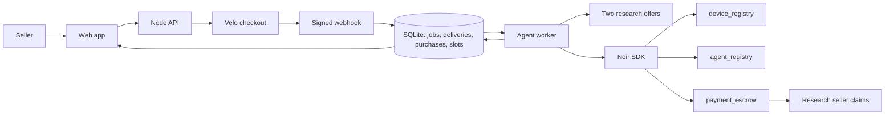

# Listo

An agent that prices your secondhand phone by buying research from paid data sellers, choosing whom to pay and how much, and paying them itself from a capped Noir allowance on Stellar.

**Live website:** https://goats-production-231d.up.railway.app
**Demo video (2 min):** _link added after recording_
**Team:** _names and Discord handles to follow_

> Runs on Stellar Testnet with test XLM only.

## Problem

People selling a used phone in the Philippines guess their asking price from a few marketplace searches. Prices for the same model swing by thousands of pesos between sellers and conditions, so sellers either underprice and lose money or overprice and wait weeks. Good price data exists, but collecting it takes time and someone has to decide which source is worth paying for.

## Solution

Listo turns pricing into a one-click order. The seller picks how fresh the price data must be and pays a 1 test XLM fee through a Velo checkout. A rule-based agent then compares two paid research sellers (run by our team, each selling a dated snapshot of real listings), picks the cheapest one that meets the freshness requirement and its own spending policy, and pays that seller from a Noir allowance it controls. The seller gets a suggested price (the median of the comparable listings the agent bought), every source listing with its link and date, and a receipt with Stellar Expert links for each payment.

## How the agentic payment works

1. **The seller pays the fee.** The browser sends only the product and freshness choice. The server creates a Velo checkout session for 1 XLM and saves its payment intent. Velo confirms the payment on the ledger and sends a signed `payment.succeeded` webhook; the server verifies it and queues exactly one job. This is the seller-authorized payment that starts the job.
2. **The agent decides whom to pay.** The worker takes the job and looks at two research offers: Basic research (1 XLM) and Recent research (2 XLM), each a dated snapshot of real listings. Recent research is refreshed by `npm run recheck-prices`; strict orders can only buy it while it is under 12 hours old. It drops offers whose data is older than the seller's limit (30 days flexible, 12 hours strict), asks Noir's `checkPayment` whether its allowance covers each remaining offer, and picks the cheapest that passes. The full decision trace is saved and shown to the seller.
3. **The agent pays.** Before touching the chain, the worker saves the purchase with its merchant, amount and nonce. It then calls Noir's `authorizePayment` with its own agent key, moving the amount from the device escrow into the chosen research seller's pending balance. The policy allows only XLM, at most 2.5 XLM per payment, until 2026-11-09 00:00 Manila; each device escrow holds 5 XLM.
4. **The research seller collects.** The worker checks the seller's pending balance matches the purchase, then the seller's key calls `claim`.
5. **The seller gets the price.** The listing is built from the purchased snapshot: median price, source links, dates.

The agent, not a person, chooses the merchant and the amount in step 2 and signs the payment in step 3. Changing the freshness requirement changes whom it pays: flexible orders buy Basic research for 1 XLM, strict orders buy Recent research for 2 XLM.

## Architecture



One Node process on Railway serves the web app and the API, runs the worker, and keeps SQLite on a persistent volume.

Safety rules that keep one payment per order:

- **Webhooks:** the raw body's signature is verified, each `x-velo-delivery` ID is recorded once, and only an event whose payment intent, amount and asset match a saved job can queue work. Dashboard test events (`test: true`) are recorded and ignored.
- **One transition:** a job leaves `awaiting_payment` once, in the same database transaction that records the delivery.
- **Unknown outcomes:** the nonce is saved before the Noir call. If the server stops mid-payment, the job goes to `review` and purchases pause. Once the original transaction can no longer land (Noir SDK transactions expire after 300 seconds), the worker replays the saved authorization as a simulation: the contract rejects a used nonce with `DuplicateAuth`, so an unused nonce proves nothing was paid and the job is safely requeued.
- **Redeploys:** on `SIGTERM` the worker tries to finish the payment in flight before exiting. If the process is killed first, the review and replay rule above covers it; order `69d890dd` in [docs/evidence.md](docs/evidence.md) recovered this way.

## Noir integration

- **SDK:** `@noirx402/agent-sdk` 0.3.0 with `@stellar/stellar-sdk` 16.4.1, Node 26.13.0.
- **Contracts (Testnet, redeployed 2026-10-24):** `device_registry` `CAC4KOLHDLDYDWBOKXNKRN5KVHO56PLOIFXDLTBUWGVN6GVDEB7FQHU5`, `agent_registry` `CCMZDSPTLX7IIJWCYEUM5DJUHOSOYSTHGK777S2TXZWEMC5ZZGPJ3EBV`, `payment_escrow` `CC7EAW5FNJEDBS7THM5IT6XIOHO4AOYMLXT3KSZ3HWUIKEACTW7E5BFS`. The client refuses to start if the SDK's built-in IDs differ.

| SDK call | Who signs | Where |
| --- | --- | --- |
| Contract ID check on startup | none | [packages/agent/src/noir.ts](https://github.com/charlesterrenal/noir-x-velo-hackathon/blob/986bca3f721d/packages/agent/src/noir.ts#L11) |
| `execute` `registerDevice` | owner | [scripts/noir-setup.ts](https://github.com/charlesterrenal/noir-x-velo-hackathon/blob/986bca3f721d/scripts/noir-setup.ts#L53) |
| `execute` `registerAgent` | owner | [scripts/noir-setup.ts](https://github.com/charlesterrenal/noir-x-velo-hackathon/blob/986bca3f721d/scripts/noir-setup.ts#L67) |
| `execute` `fundEscrow` | owner | [scripts/noir-setup.ts](https://github.com/charlesterrenal/noir-x-velo-hackathon/blob/986bca3f721d/scripts/noir-setup.ts#L80) |
| `checkPayment` with `requireEscrow` | none (read) | [apps/server/src/worker.ts](https://github.com/charlesterrenal/noir-x-velo-hackathon/blob/986bca3f721d/apps/server/src/worker.ts#L125) |
| `authorizePayment` with a saved nonce | agent | [apps/server/src/worker.ts](https://github.com/charlesterrenal/noir-x-velo-hackathon/blob/986bca3f721d/apps/server/src/worker.ts#L160) |
| `claim` | research seller | [apps/server/src/worker.ts](https://github.com/charlesterrenal/noir-x-velo-hackathon/blob/986bca3f721d/apps/server/src/worker.ts#L191) |
| `prepare` to replay an unknown authorization | none (simulation) | [apps/server/src/worker.ts](https://github.com/charlesterrenal/noir-x-velo-hackathon/blob/986bca3f721d/apps/server/src/worker.ts#L79) |

The agent's choice of seller is [`selectOffer`](https://github.com/charlesterrenal/noir-x-velo-hackathon/blob/986bca3f721d/packages/agent/src/offers.ts#L80). The purchase and nonce are saved [before the chain write](https://github.com/charlesterrenal/noir-x-velo-hackathon/blob/986bca3f721d/apps/server/src/worker.ts#L152).

## Velo integration

- **SDK:** `@carts1024/velo-sdk` 0.1.0-alpha.4, the `alpha` tag the handbook specifies.
- **What Velo does here:** hosted checkout for the seller's fee, ledger-confirmed payment status, and signed webhooks that start the agent's work.

| Use | Where |
| --- | --- |
| Create a checkout session with an idempotency key per job | [apps/server/src/jobs.ts](https://github.com/charlesterrenal/noir-x-velo-hackathon/blob/986bca3f721d/apps/server/src/jobs.ts#L54) |
| Webhook route on the raw body, before any JSON parser | [apps/server/src/index.ts](https://github.com/charlesterrenal/noir-x-velo-hackathon/blob/986bca3f721d/apps/server/src/index.ts#L12) |
| `Velo.webhooks.verify` | [apps/server/src/velo.ts](https://github.com/charlesterrenal/noir-x-velo-hackathon/blob/986bca3f721d/apps/server/src/velo.ts#L54) |
| Delivery dedupe on `x-velo-delivery` | [apps/server/src/velo.ts](https://github.com/charlesterrenal/noir-x-velo-hackathon/blob/986bca3f721d/apps/server/src/velo.ts#L73) |
| Test events recorded but never queued | [apps/server/src/velo.ts](https://github.com/charlesterrenal/noir-x-velo-hackathon/blob/986bca3f721d/apps/server/src/velo.ts#L78) |
| Intent, amount and asset match, then the single transition to `queued` | [apps/server/src/velo.ts](https://github.com/charlesterrenal/noir-x-velo-hackathon/blob/986bca3f721d/apps/server/src/velo.ts#L92) |

One workaround: the live Testnet backend sends `project.registryProjectId` as a number, which the SDK's shape check rejects after the HMAC has already matched. In that case only, the server [parses the fields it needs itself](https://github.com/charlesterrenal/noir-x-velo-hackathon/blob/986bca3f721d/apps/server/src/velo.ts#L59). Payloads with a bad signature are still rejected.

## Testnet proof

Order `a1a77d64`, flexible freshness:

- Seller pays the fee through Velo: [c218cb9c…](https://stellar.expert/explorer/testnet/tx/c218cb9c89f2036957d989fa06b50b7b1a2684206f29736d0553e397fa55e663)
- Agent pays Basic research 1 XLM through Noir: [1f5f9bb4…](https://stellar.expert/explorer/testnet/tx/1f5f9bb469098dbaa88f69a96a9c80fb30e9217bf06d262c2b7e7e220e4e4296)
- Research seller claims: [a36c0eae…](https://stellar.expert/explorer/testnet/tx/a36c0eae7b271383f15a652026510dea9df0bc1ea421f49fa798e9382696f172)

All transactions, including the strict-freshness order, Velo project setup and Noir provisioning, are in [docs/evidence.md](docs/evidence.md).

## Repo structure

```
apps/web/         Seller page: order form, live job progress, receipt (Vite)
apps/server/      Express API, Velo webhook, SQLite, agent worker
packages/agent/   Offer selection, research snapshots, Noir client
packages/shared/  API types shared by web and server
scripts/          Noir provisioning, Noir smoke test, price re-check, doc link check
docs/             Evidence, operations runbook, write-up, screenshots
```

## Run it locally

1. Install Node 26.13.0 (see `.node-version`). You need a Velo Testnet project and API key from [velo-build.dev](https://www.velo-build.dev), and a Testnet wallet such as Varial (formerly Freighter) to pay the checkout.
2. Run `npm install` at the root.
3. Copy `.env.example` to `.env` and set `VELO_API_KEY`, `VELO_WEBHOOK_SECRET`, and `PUBLIC_BASE_URL=http://localhost:5173` (where Velo sends the seller back after paying).
4. Run `npm run noir:setup -- --count 2`. It creates and funds the owner, agent and two research-seller accounts with Friendbot, writes their secrets to `.env`, provisions two Noir devices, and prints the `DEVICE_HASHES` line to add to `.env`.
5. Start the server and web app in two terminals: `npm run dev:server` (API on port 3000) and `npm run dev:web`.

Checkout works locally, but Velo can only deliver webhooks to a public HTTPS URL, so a full order needs a deployment or a tunnel. Production: `npm run build && npm start`. Day-to-day procedures are in [docs/operations.md](docs/operations.md). Checks: `npm run typecheck`, `npm test`.

## Environment variables

| Name | What it is | Where to get it |
| --- | --- | --- |
| `PUBLIC_BASE_URL` | Public URL of the app, used for checkout return links | Your host |
| `PORT` | HTTP port | Your host (Railway sets it) |
| `DATA_DIR` | Folder for the SQLite database; must be a persistent disk in production | Your host |
| `DEVICE_HASHES` | Comma-separated funded Noir devices, one per order slot | Printed by `npm run noir:setup` |
| `VELO_API_KEY` | Velo project API key (General project API) | Velo dashboard, Build, API Keys |
| `VELO_WEBHOOK_SECRET` | Webhook signing secret | Velo dashboard, Observe, Webhooks |
| `AGENT_SECRET` | The agent's Stellar secret key; signs `authorizePayment` | Created by `npm run noir:setup` |
| `MERCHANT_BASIC_SECRET` | Basic research seller's secret key; signs `claim` | Created by `npm run noir:setup` |
| `MERCHANT_RECENT_SECRET` | Recent research seller's secret key; signs `claim` | Created by `npm run noir:setup` |
| `NOIR_SETUP_OWNER_SECRET` | Device owner's key for provisioning. Local only, never on the host | Created by `npm run noir:setup` |

## Screenshots

_Added after the redesign ships._

## What's next

- Price any item the seller types, with live research instead of curated snapshots.
- More research sellers with different prices and sources, so the agent's choice has more to weigh.
- Return an order's slot when its checkout expires, and refund the fee when the agent can't buy.
- An owner dashboard for allowances, revocation and remaining escrow.

## Credits

- [Noir](https://github.com/noirx402/noir) agent SDK and Testnet contracts; [Velo](https://github.com/Velo-Ecosystem-Collection/Velo) SDK; [Stellar JavaScript SDK](https://github.com/stellar/js-stellar-sdk).
- [Express](https://expressjs.com), [Vite](https://vite.dev), Node's built-in `node:sqlite`.
- Fonts: Bricolage Grotesque and IBM Plex Mono from Google Fonts.
- Price data: public listings from [Allo Allo](https://www.alloallo.com/ph/) and [CompAsia](https://compasia.com.ph), collected as dated snapshots, not live search.
